# 守夜：山村旧影

**一款以雨夜古宅为背景的单人第三人称中式民俗恐怖调查游戏。**

> 灯笼还亮着，院里却没人。陈默带着一支手电走进王宅。要在天亮前离开，他得先弄清楚：这座宅子里，有什么事被人刻意留在了黑暗里？

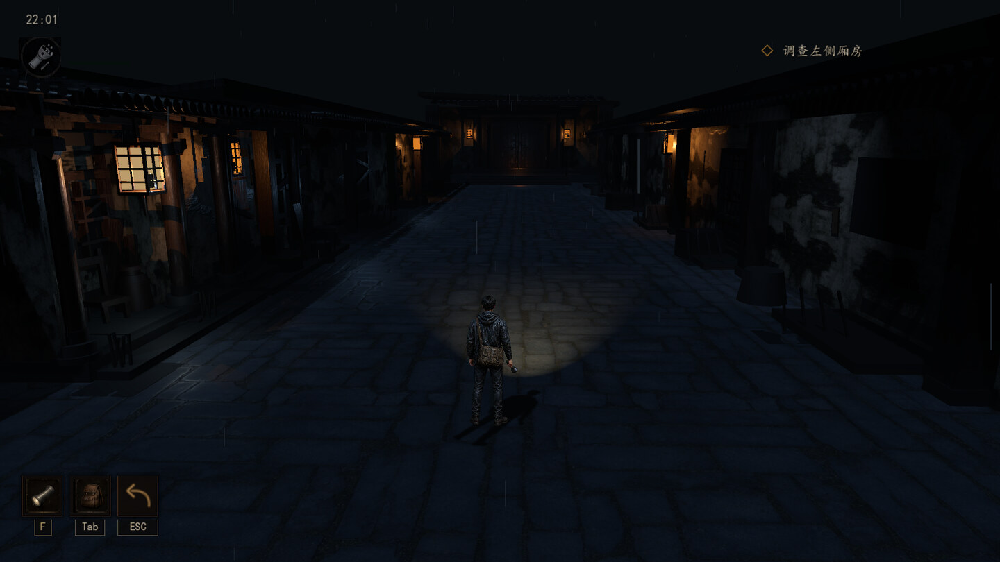

`Godot 4.7.1` · `Forward+` · `简体中文` · `Windows 测试版`

[玩法与操作](#玩法与操作) · [超时失败画面](#超时失败画面) · [实机场景](#实机场景) · [美术与声音设计](#美术与声音设计) · [从源码运行](#从源码运行) · [存档与设置](#存档与设置) · [项目结构](#项目结构) · [完成度与已知问题](#完成度与已知问题)

## 游戏简介

玩家扮演陈默，在一场雨夜中调查封闭多年的王宅。从庭院进入正堂，再到家族书房和上锁的旧卧房。散落的旧物、缺页的家谱和互相矛盾的记录，会逐渐改变你对这座宅子的理解。

调查主要依靠**手电、环境痕迹与声音方向**。同一件东西可能只是一件陈设，也可能在获得另一条线索后变得值得重新查看。游戏采用环境叙事与空间声音推进主线，没有战斗系统。本文只介绍场景与基本操作，不公开关键线索解法、人物身世或结局画面。

王宅的调查分三个阶段：**认路与入宅**，先在雨声和灯笼之间找到入口；**核对旧物**，把不同房间里的文字、物证和居住痕迹联系起来；**循声与返程**，回到先前经过的地方，用已经取得的信息重新观察熟悉的空间，最后沿原路寻找出口。部分交互会在读完对应线索后开放，所以同一扇门、同一段回廊，在前后两次经过时可能承担不同的作用。

## 玩法与操作

- **搜查房间：** 走近门、家具或物证，等候交互提示。灯光能帮助你辨认湿砖上的痕迹和藏在阴影里的细节。
- **整理线索：** 物品拾取后进入背包。点选物品可读说明；有正文的线索可以展开、翻页和重读。部分剧情以最后一页的查看记录为准。
- **辨认声源：** 雨声、木响、远处脚步会随剧情或空间位置变化。配合任务提示和手电定位，不必只盯着右上角。
- **在天亮前离开：** 夜间计时从 **22:00** 到次日 **06:00**，每真实 **1 秒**推进游戏内 **1 分钟**，合计约 **8 分钟有效计时**。打开背包会暂停计时，部分锁定操作的剧情演出也会停表。06:00 前须带着证据到宅门提交离开；超时会进入失败画面，可以重新尝试或返回主菜单。

| 按键 | 功能 |
| --- | --- |
| `W` `A` `S` `D` / 方向键 | 移动角色 |
| `E` | 调查、拾取、开门等；以现场提示为准 |
| `F` | 开关手电筒 |
| `Tab` | 打开或关闭背包；阅读时可退出当前文件 |
| 鼠标左键 | 选择菜单、切换背包物品、点击「展开阅读」和关闭按钮 |
| `A` / `D` 或 `←` / `→` | 背包或文件打开时，上一页 / 下一页 |
| `Esc` | 关闭阅读、背包或返回；场景返回行为以当前提示为准 |

**初次游玩：** 主菜单的「操作查看」中可以调整雨声与环境音、雷声音量，也可以勾选「减少雷电闪光」。游戏含昏暗空间、雷声和哭声，以及关于囚禁与死亡的故事情节。

如果调查暂时没有推进，可以先检查三件事：右上角当前目标是什么、手上的文件是否还有下一页、要找的痕迹是否在手电照到的范围内。展开文件阅读时可以慢慢看；背包里的「展开阅读」可用于重看已取得的文件，无需回到拾取点。

| 主菜单 | 背包「行囊」 | 旧纸阅读界面 |
| --- | --- | --- |
| [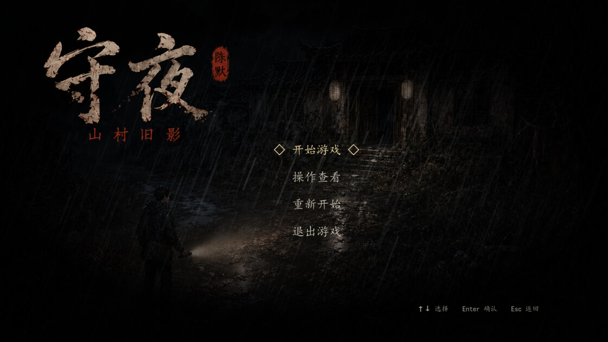](docs/readme/main-menu.jpg) | [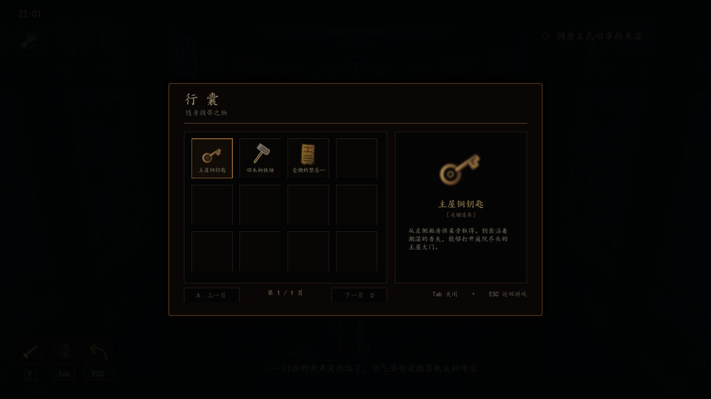](docs/readme/inventory.jpg) | [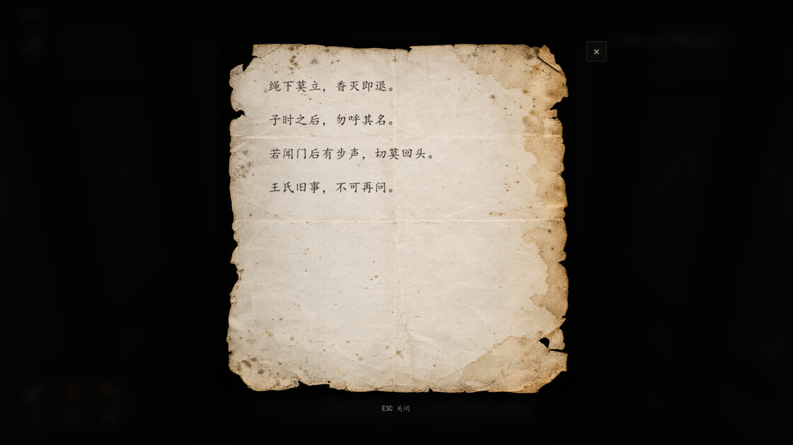](docs/readme/document-reader.jpg) |

### 超时失败画面

时钟到达 **06:00** 时，如果还没在宅门提交离开，游戏会暂停。画面保留玩家所在场景，雷声先响，随后传来哭声，并浮现「游戏失败」与「真相仍埋在王宅深处」。可以重新尝试；已有检查点时可从检查点重试，也可返回主菜单。

[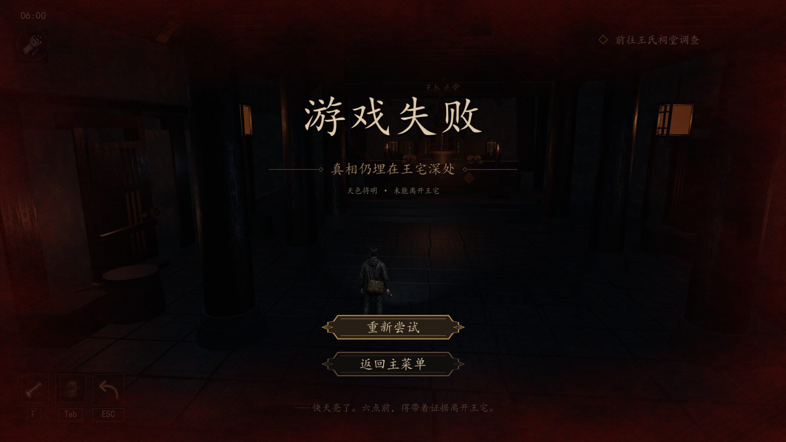](docs/readme/night-failure.jpg)

*当前游戏实机截图：陈默在王氏正堂停留至 06:00，失败界面及按钮完整出现后截取。点击可查看大图。*

## 实机场景

以下画面来自当前 Godot 项目的实际渲染。部分近景使用取景相机，便于看清材质与道具细节。点击图片可查看原尺寸文档图。

| **庭院右廊** · 关掉手电后，冷光仍能勾出旧墙、格窗和柱础。 | **王氏正堂** · 烛光集中在供台与牌位，厅柱和外围回廊留在阴影中。 |
| --- | --- |
| [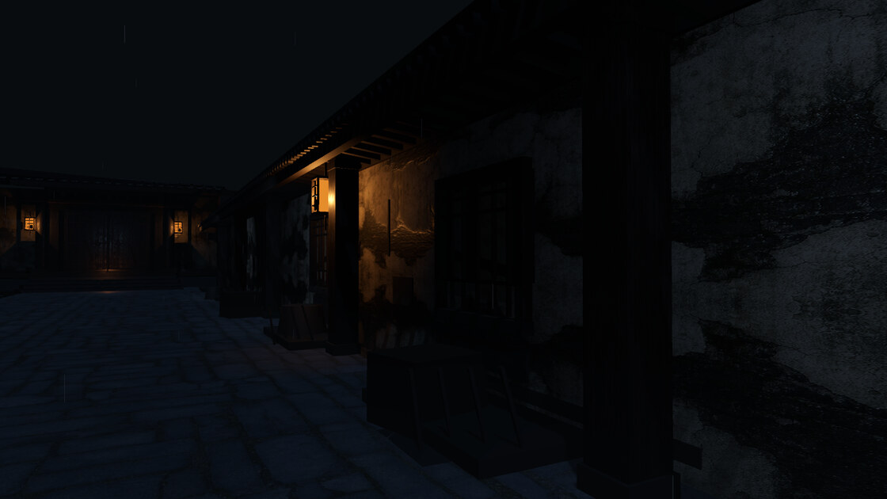](docs/readme/rain-gallery.jpg) | [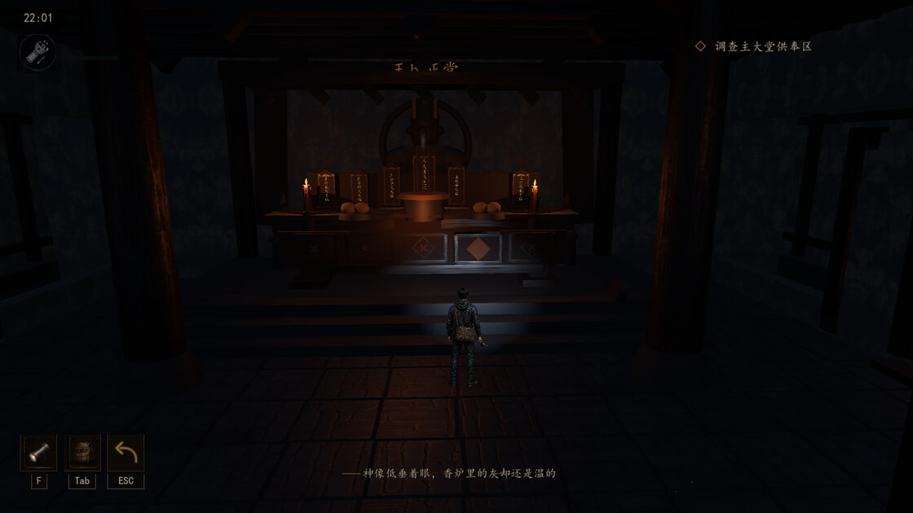](docs/readme/main-hall.jpg) |
| **王家旧书房** · 旧书案、线装册、卷宗和打开的家谱构成调查中心。 | **封镜旧卧房** · 褪色床幔与铜镜分处冷暖两侧，中央通路留空。 |
| [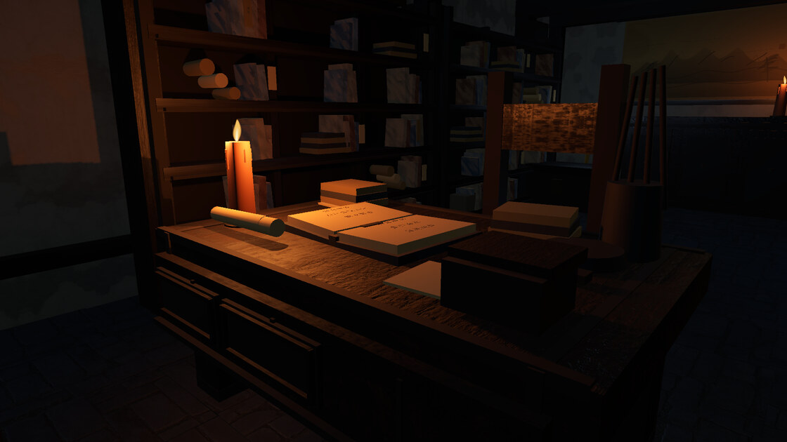](docs/readme/wang-study.jpg) | [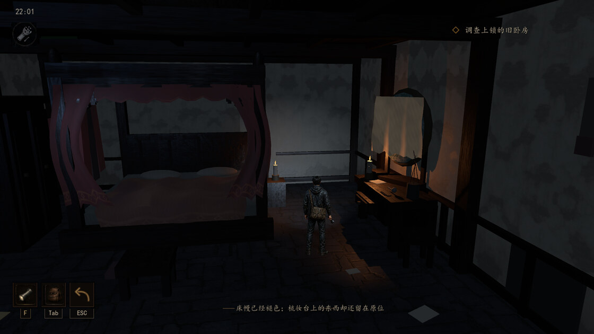](docs/readme/sealed-bedroom.jpg) |
| **西厢吊绳房** · 香炉、旧木凳、黄符和纸钱在局部烛光下显出层次。 | **旧卧房床铺近景** · 下垂的被褥、松塌的枕头和磨旧织边保留了生活痕迹。 |
| [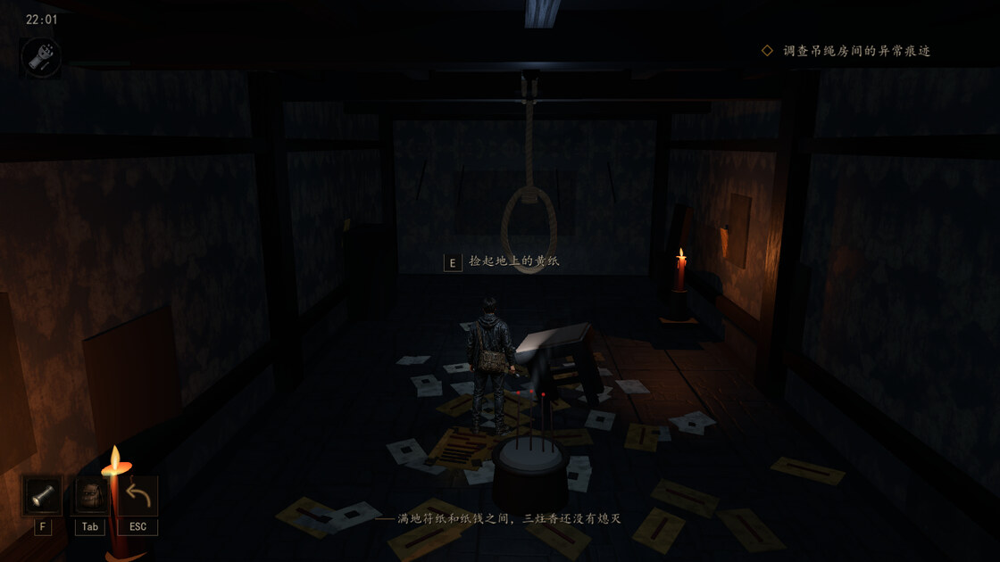](docs/readme/west-wing.jpg) | [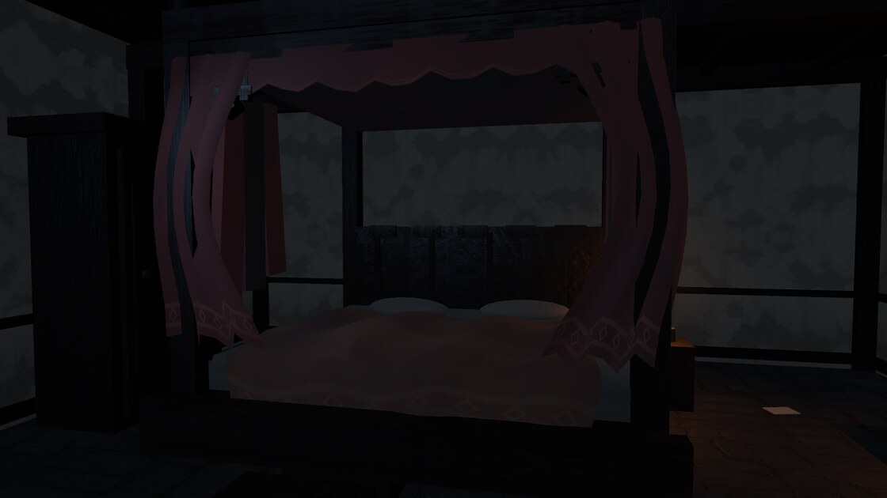](docs/readme/sealed-bedroom-bed.jpg) |

| **宅外入口** · 屋檐、台阶和门边的微光建立第一段路线。 | **左厢钥匙房** · 昏暗长廊把视线引向远端供桌，是入宅初期的探索区域。 |
| --- | --- |
| [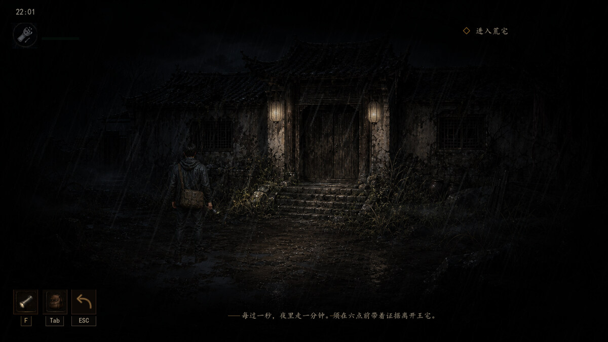](docs/readme/exterior.jpg) | [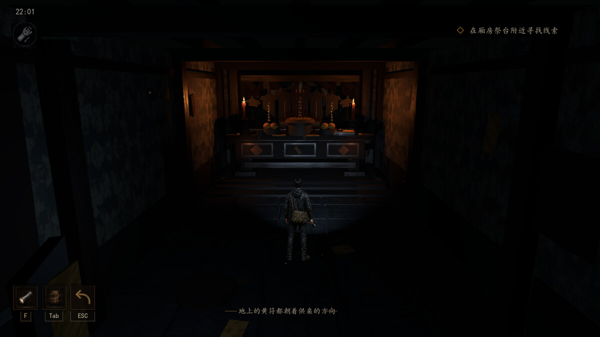](docs/readme/key-room.jpg) |

## 美术与声音设计

**光源负责不同的事。** 庭院的灯笼主要用来认路，偏冷的夜光保留木柱和屋檐轮廓；正堂的暖光集中在供台，书房让烛光落在打开的家谱上，卧房把暖光留给梳妆台、把床铺留在冷暗处。手电用来辨认局部的潮湿砖面、纸张和旧木磨损。

**调查痕迹贴在实际场景里。** 潮湿脚印通过地面材质表现为颜色与湿度差异，随青砖接缝出现，没有导航箭头。下图用近景相机拍摄，保留游戏的地面材质和手电光，不加标记。

[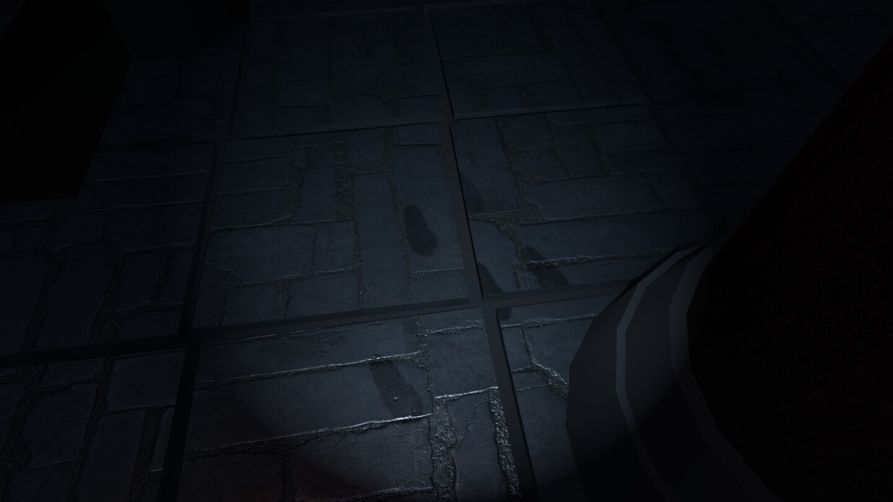](docs/readme/wet-footprints.jpg)

**声音会告诉玩家该往哪看。** 雨声和木构响动建立底噪；脚步、门板敲击与哭声在特定段落使用空间音源。演出有时会先压低环境音，再留下短暂安静，让玩家自行辨认声源。关门、熄烛与声音变化也能让同一个场景在返程时呈现不同的状态。

## 从源码运行

当前验收环境为 **Windows、Godot 4.7.1、Forward+**。项目包含 3D 动态光照与雨夜反射，首次打开时请等资源导入完毕。目前没有经过验证的最低硬件配置，也没有独立的正式发行版可下载。

1. 打开 Godot 项目管理器，选择「导入」，选中根目录下的 [`project.godot`](project.godot)。
2. 导入完成后按 `F6` 可预览当前打开的场景；第一次试玩请按 **`F5` 运行整个项目**，从主菜单点「开始游戏」。主入口是 [`scenes/Main.tscn`](scenes/Main.tscn)。
3. 主菜单有检查点时会显示「继续游戏」；没有检查点时显示「开始游戏」。如果要从头试玩，请先看下方的[存档与设置](#存档与设置)，避免误清已有进度。

<details>
<summary>开发者：Windows 导出与启动检查</summary>

安装与编辑器版本匹配的 Windows x64 导出模板。然后在 Godot 的「项目 → 导出」中选择 `Windows Desktop`，导出到 `dist/Shouye.exe`。项目已有 [`export_presets.cfg`](export_presets.cfg)，其中设置了将资源包嵌入 EXE。也可从项目根目录运行以下 PowerShell 命令，将第一行替换为本机的 Godot 可执行文件路径：

```powershell
$godot = 'C:\path\to\Godot_v4.7.1-stable_win64.exe'
& $godot --headless --path . --quit-after 120
New-Item -ItemType Directory -Force -Path dist | Out-Null
& $godot --headless --path . --export-release 'Windows Desktop' 'dist/Shouye.exe'
```

第一条运行命令用于检查项目能否启动。导出后还应在没有编辑器的 Windows 环境中测试新游戏、继续游戏、超时重试与完整结局。现有旧 `.pck` 需要 Godot 或兼容的运行程序加载，不能当作当前版本的独立安装包。

</details>

## 存档与设置

| 操作或文件 | 行为 |
| --- | --- |
| **继续游戏** | 恢复最近的有效检查点，并恢复当时的背包、已读文件、手电状态和对应剧情进度。检查点恢复时至少留出 **90 秒有效计时**；正在进行的本轮游戏不会因此加时。 |
| **重新开始** | **清除当前检查点**，从宅外开启新一轮。音量与闪光设置单独保存。 |
| **失败后重试** | 有检查点时恢复该检查点；没有时从宅外重新开始。只选「返回主菜单」不会清除检查点。 |
| `user://investigation_checkpoint.cfg` | 当前检查点文件。游戏在终章开启、首次循脚印重返西厢，以及告别完成、解锁离宅时自动保存。不能在任意房间手动保存。 |

告别完成后退出，再选择「继续游戏」会从告别后的西厢恢复：供词与已取得的完整银簪仍在背包，麻绳已落地，香炉已恢复细烟，可以直接踏上返程。旧版检查点仍可读取；如果旧版退出时尚未写下告别进度，需要从旧检查点完成一次告别。
| `user://presentation_settings.cfg` | 雨声与环境音、雷声音量、减少雷电闪光等个人设置。 |

在 Windows 上，可以通过 Godot 编辑器的「项目 → 打开用户数据文件夹」查看当前项目的 `user://`。如果声音太强或不适应闪光，建议在主菜单「操作查看」中先调整再开始。

[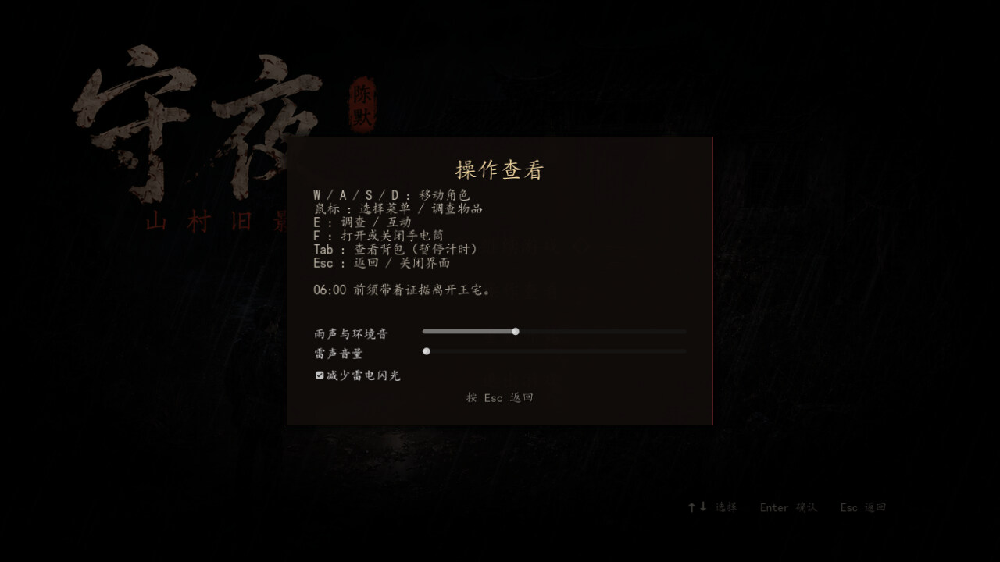](docs/readme/settings.jpg)

## 项目结构

| 路径 | 内容 |
| --- | --- |
| [`project.godot`](project.godot) / [`scenes/Main.tscn`](scenes/Main.tscn) | 项目配置、输入映射、主入口 |
| [`scenes/`](scenes/) | 主菜单、庭院、左厢、王氏正堂、旧书房、封镜旧卧房、西厢吊绳房与 UI 场景 |
| [`scripts/game_state.gd`](scripts/game_state.gd) | 全局时间、物品、剧情标记、检查点与设置 |
| [`scripts/exterior_hud.gd`](scripts/exterior_hud.gd) | HUD、任务提示、字幕、背包与文件阅读 |
| [`scripts/`](scripts/) | 各场景交互、空间音频、追踪脚印和终章演出 |
| [`materials/`](materials/) / [`shaders/`](shaders/) | 青砖、旧木、墙面、织物、纸张等场景材质 |
| [`assets/`](assets/) | 美术资源、字体、音频及来源记录 |
| [`docs/`](docs/) | 美术规范、剧情实现记录、验收报告与 README 配图 |

<details>
<summary>开发者：关键系统的代码入口</summary>

| 想检查什么 | 从哪里开始 |
| --- | --- |
| 主菜单、开场与换场 | [`start_menu.gd`](scripts/start_menu.gd) 处理开始、继续和重开；[`main.gd`](scripts/main.gd) 负责载入当前场景。 |
| 06:00 计时与失败 | [`game_state.gd`](scripts/game_state.gd) 推进夜间时间并管理暂停、检查点和超时；[`night_failure_screen.gd`](scripts/night_failure_screen.gd) 控制失败页、雷声、哭声与重试按钮。 |
| 正堂、西厢与出口 | [`main_hall_final_investigation.gd`](scripts/main_hall_final_investigation.gd)、[`hanging_room_door_story.gd`](scripts/hanging_room_door_story.gd) 和 [`wang_estate_departure.gd`](scripts/wang_estate_departure.gd) 分别处理各自场景的调查、演出和宅门离开。 |
| 脚印与材质 | [`yuelan_footprint_route.gd`](scripts/yuelan_footprint_route.gd) 将足迹数据传给现有地面材质；[`interior_wet_brick.gdshader`](shaders/interior_wet_brick.gdshader) 负责湿润表现。 |

</details>

## 完成度与已知问题

**主线和结局已达到可玩验收，正式发行验收尚未完成。** 此前的 30 项检查中，29 项通过，另 1 项复现了告别后的存档回退；该问题已修复，并在两个独立的 Godot 进程中验证了告别后的保存与继续。已检查 720p 界面和多个场景的运行画面；分段用例会设置前置剧情状态，不能替代首次玩家按原速从头到尾的盲玩。

| 项目 | 当前情况 |
| --- | --- |
| 正式 Windows 包 | 新导出的测试 PCK 可由 Godot 加载；独立 EXE 尚未验收。`dist` 中旧 PCK 早于最近的美术更新。 |
| 低配性能 | 庭院是当前采样中绘制负担最高的场景，尚未验证低配机器的帧率与长期稳定性。 |
| 公开版音效 | 正堂哭声、西厢抽泣、终章走廊脚步和旧木门声使用可重新生成的合成素材；本地原录音及派生片段不随仓库分发。 |

- [最终验收报告](docs/final_game_acceptance_20261110.md)：测试范围、通过结果与发行前待办。
- [场景美术规范](docs/art/02_art_bible.md)：旧宅材质、灯光与空间表现原则。
- [时间、文档与字幕修复记录](docs/narrative_reading_clock_fixes.md)：计时和阅读门槛的实现背景。

<details>
<summary>开发者：在本地复测阅读与计时</summary>

源码工作区带有 `tmp/` 下的验收脚本，正式游戏不包含这些脚本。如果检出的副本也有这些文件，可在项目根目录执行下列 PowerShell 命令。命令为测试使用独立用户数据目录，避免覆盖正常试玩的设置和进度：

```powershell
$godot = 'C:\path\to\Godot_v4.7.1-stable_win64.exe'
$savedAppData = $env:APPDATA
$testProfile = Join-Path (Get-Location).Path ('tmp\readme-audit-' + [guid]::NewGuid().ToString('N'))
New-Item -ItemType Directory -Force -Path $testProfile | Out-Null
try {
    $env:APPDATA = $testProfile
    & $godot --headless --path . --script res://tmp/validate_document_reader.gd
    if ($LASTEXITCODE -ne 0) { throw 'Document reader regression failed' }
    & $godot --headless --path . --script res://tmp/validate_narrative_fixes.gd
    if ($LASTEXITCODE -ne 0) { throw 'Narrative and clock regression failed' }
} finally {
    $env:APPDATA = $savedAppData
}
```

通过标记为 `DOCUMENT_READER_OK` 与 `NARRATIVE_FIXES_OK`。这些用例检查分页、阅读门槛、字幕和计时；实际画面、空间音频与限时通关仍需启动游戏验收。

</details>

本 README 的场景截图整理在 [`docs/readme/`](docs/readme/)，不依赖临时测试目录。本文档不授予项目源码、素材或游戏画面的再分发许可。

公开版替代音效位于 [`assets/audio/public_effects/`](assets/audio/public_effects/)，已随仓库提供。若需重新生成，可在项目目录运行 `python scripts/tools_generate_public_audio.py`；脚本只用 Python 标准库，不读取外部录音。
